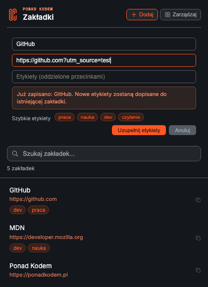
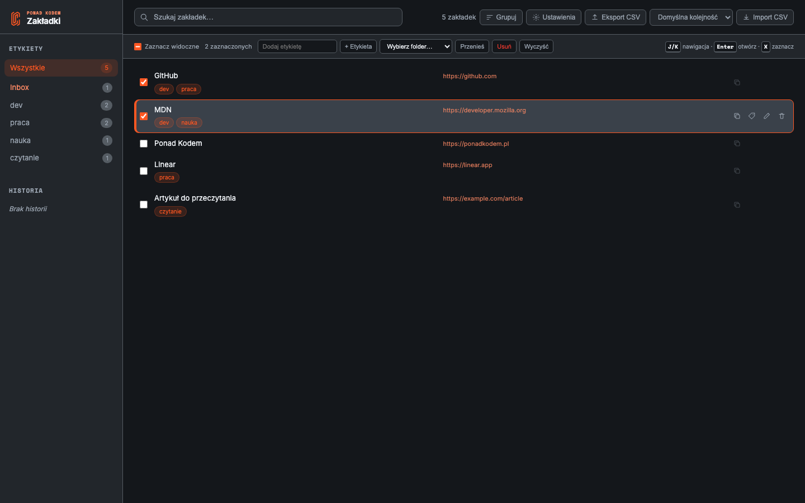

<p align="center">
  
</p>

<h1 align="center">Ponad Kodem Bookmarks</h1>

<p align="center">
  A private Chrome bookmarks manager with fast search, labels, Inbox, and bulk actions.<br>
  No accounts, no cloud, no ads.
</p>

<p align="center">
  <a href="https://cezarysanecki.github.io/chrome-bookmarks-manager/">Project page</a>
</p>

---

<p align="center">
  
  
</p>

---

The extension works directly with Chrome bookmarks. The interface is in Polish.

## Installation

1. Download or clone the repository into a permanent directory.
2. Open `chrome://extensions`.
3. Enable **Developer mode**.
4. Click **Load unpacked** and select the extension directory.
5. Open `chrome://extensions/shortcuts` to review the shortcuts.

The key stored in `manifest.json` keeps the local extension ID stable, so shortcut assignments survive Chrome restarts and code updates. Keep using the same directory and the **Reload** button instead of installing additional copies.

## Quick start

| Action | How |
|---|---|
| Open the popup | Click the toolbar icon or press `Alt+Shift+B` |
| Bookmark the current page | `Alt+Shift+D` |
| Open the full-page manager | Click **Zarzadzaj** in the popup |
| Search | Start typing; results filter immediately |

## Features

### Fast search

Search matches the bookmark title, URL, and labels anywhere in the text.

### Labels that sync with Chrome

Labels are stored directly in the bookmark title:

```text
Page name | label1, label2
```

Because the label data remains part of the Chrome bookmark, it synchronizes through the user's Google account without a separate backend.

### Safe bookmark creation

Before creating a bookmark, the extension compares normalized URLs while ignoring `www`, tracking parameters, and anchors. If the page already exists, it updates the existing bookmark with the selected labels instead of creating another copy.

The add form suggests existing and recently used labels.

### Inbox

The **Inbox** view contains every bookmark without a label, providing a focused queue for organizing recently saved pages.

### Bulk actions

Select multiple bookmarks in the full-page view to:

- add shared labels;
- move them to a Chrome bookmark folder;
- delete them, with operations recorded in the history for undo.

### Two focused views

The popup is limited to search, open, copy, and add. Editing, labels, folders, duplicate cleanup, history, and CSV import/export live in the full-page view.

### Editing, deletion, and history

Hover over a bookmark to edit its title, URL, or labels, or to delete it. Edit, label, move, and delete operations are saved in the local history and can be undone.

### Duplicate cleanup

The **Duplikaty** section groups bookmarks that resolve to the same normalized URL.

### CSV export and import

- **Export** downloads `title`, `url`, and `tags` columns as UTF-8 CSV.
- **Import** reads the same format and skips URLs that already exist.

### Grouping and sorting

The full-page view can group bookmarks by label and sort them in Chrome order, alphabetically, or by domain. Preferences persist between sessions.

## Settings

The full-page settings contain one optional feature:

- **Favicons**: fetch and display domain icons from Google's favicon service.

## Keyboard shortcuts

| Shortcut | Action |
|---|---|
| `Alt+Shift+B` | Open or close the popup |
| `Alt+Shift+D` | Bookmark the active page |
| `Up` / `Down` | Navigate in the popup |
| `/` | Focus full-page search |
| `J` / `K` or `Up` / `Down` | Navigate in the full-page view |
| `Enter` | Open the highlighted bookmark |
| `X` or `Space` | Select a bookmark for bulk actions |
| `E` / `T` / `Y` | Edit / manage labels / copy URL |
| `Delete` | Delete the highlighted bookmark |
| `Escape` | Close a dialog or settings |

## Privacy

- Bookmark data remains in Chrome.
- Settings, recent labels, and change history are stored in `chrome.storage.local`.
- Labels remain in bookmark titles and sync through Chrome.
- When favicons are enabled, bookmark domains are sent only to Google's favicon service.

Full privacy policy: [cezarysanecki.github.io/chrome-bookmarks-manager/#privacy](https://cezarysanecki.github.io/chrome-bookmarks-manager/#privacy)

## Development

```bash
npm install
npm test
```

Tests use Vitest.

## License

MIT, see [`LICENSE`](LICENSE).
