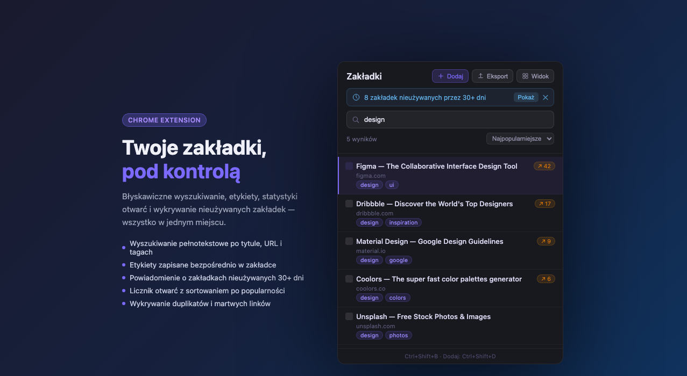
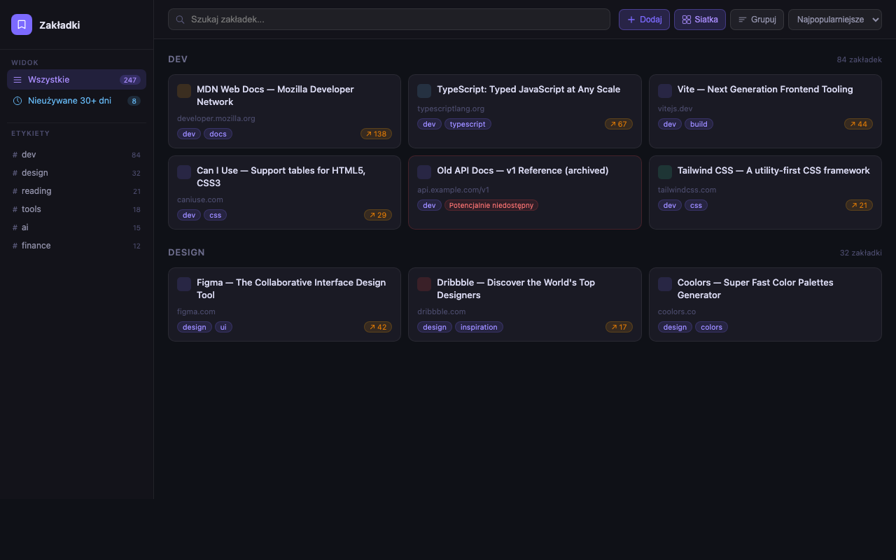

<p align="center">
  
</p>

<h1 align="center">Bookmarks Manager</h1>

<p align="center">
  A private Chrome bookmarks manager with search, labels, open statistics and optional AI.<br>
  No accounts, no cloud, no ads.
</p>

<p align="center">
  <a href="https://cezarysanecki.github.io/chrome-bookmarks-manager/">Project page</a>
</p>

---

<p align="center">
  
  
</p>

---

The extension works on Chrome's own bookmarks, so nothing has to be imported or synced separately. The interface is in Polish 🇵🇱 PL.

## Installation

1. Download or clone the repository.
2. Open `chrome://extensions` in Chrome.
3. Turn on **Developer mode** (top right corner).
4. Click **Load unpacked** and select the extension folder.

## Quick start

| Action | How |
|---|---|
| Open the manager | Click the toolbar icon or press `Ctrl+Shift+B` |
| Bookmark the current page | `Ctrl+Shift+D` |
| Open the full-page view | **Widok** button in the popup |
| Search | Start typing; results filter as you type |

## Features

### Search
Search matches the **title, URL and labels**, anywhere in the text, not only at the beginning.

### Labels
Bookmarks can be grouped by labels. Labels are stored in the bookmark title:

```
Page name | label1, label2
```

- Click the **label** icon next to a bookmark to add or remove labels.
- Click a label in the list to show only bookmarks with that label.
- In the full-page view the left panel lists all labels with bookmark counts.
- The **Bez etykiet** bar in the popup shows bookmarks without any label.

### Open statistics and sorting by popularity
Every time a bookmark is opened, it is counted. A `↗ N` badge shows the count. The default **Najpopularniejsze** sort puts the most used bookmarks on top. Other sort options:

- Chrome's default order
- A → Z / Z → A
- By domain

The chosen sort is remembered between sessions.

### Unused bookmarks (30+ days)
The extension finds bookmarks that have not been opened for more than 30 days. The popup shows a bar with their count and a **Pokaż** button to review them.

### Editing and deleting
Hover over a bookmark to see the actions:
- **Edit**: change the title, URL and labels in place.
- **Delete**: asks for confirmation. After deleting, you have **6 seconds** to undo it from the notification.

### Change history and undo
Every delete, edit and label change is recorded. In the full-page view the **Historia** section lists recent operations, and each one can be undone with `↩`.

### Copying a link
The copy icon next to each bookmark copies its URL to the clipboard.

### Similar bookmarks
The **Podobne** button filters the list to bookmarks from the same domain or with a similar title, which helps to find topical duplicates.

### Duplicate URLs
The extension compares URLs while ignoring `www`, tracking parameters and `#` anchors. When it finds duplicates:
- the popup shows a bar with their count and a **Pokaż** button,
- the full-page view groups them under **Duplikaty** in the left panel, ready to review and delete.

### CSV export and import
- **Export** downloads a `.csv` file with the titles, URLs and labels of all bookmarks (opens in Excel).
- **Import** reads a `.csv` file in the same format and skips bookmarks that already exist.

Columns: `title`, `url`, `tags` (labels separated by semicolons).

### Grid view and grouping
The full-page view has two switches that can be combined:
- **Siatka** shows bookmarks as tiles instead of a list,
- **Grupuj** groups bookmarks by label into sections.

Both settings are remembered between sessions.

## Settings

Open them from the full-page view with the **Ustawienia** button. `Escape` closes them.

### Favicons *(off by default)*
Shows the domain icon next to each bookmark.

### Dead link check *(off by default)*
Each time the full-page view opens, the extension checks every bookmark with a HEAD request (6 s timeout). Bookmarks that may be unavailable get a **Potencjalnie niedostępny** badge.

> With many bookmarks this can slow the view down noticeably.

### AI label suggestions *(off by default, needs an OpenAI key)*
With an API key set, each bookmark gets a star button. Clicking it sends the title and URL to **GPT-4o mini** and shows suggested labels to pick from.

The OpenAI key is stored only in the browser and is sent only to OpenAI.

## Keyboard shortcuts

| Shortcut | Action |
|---|---|
| `Ctrl+Shift+B` | Open or close the popup |
| `Ctrl+Shift+D` | Bookmark the current page |
| `↑` / `↓` | Move through the list in the popup |
| `Enter` | Open the highlighted bookmark |
| `/` | Focus the search field (full-page view) |
| `Escape` | Close a dialog or settings, clear the highlight |

## Privacy

- Bookmarks, change history and settings stay in the browser. Optional features can send HEAD requests to bookmark URLs, fetch favicons from Google, or send a title and URL to OpenAI.
- Labels live in the Chrome bookmark title, so they sync between devices through your Google account with no extra infrastructure.
- Change history and settings are saved in `chrome.storage.local` and never leave the browser.

Full privacy policy: [cezarysanecki.github.io/chrome-bookmarks-manager/#privacy](https://cezarysanecki.github.io/chrome-bookmarks-manager/#privacy)

## Development

```bash
npm install
npm test
```

Tests use Vitest.

## License

MIT, see [`LICENSE`](LICENSE).
